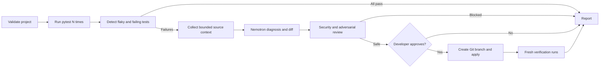

# breakmycode

[](https://www.python.org/)
[](LICENSE)
[](#evaluations)
[](https://tokenfactory.nebius.com/)

`breakmycode` is a human-supervised Python testing and debugging agent. Point it
at an existing local Python project and it can generate additional pytest tests,
run the suite repeatedly to expose flaky behavior, explain failures with NVIDIA
Nemotron through Nebius Token Factory, and propose a verified fix.

Every generated-test or code-fix diff is printed first. Nothing is written
without an explicit `y`, and approved changes are isolated on a new Git branch.

```bash
# Generate additional tests for an existing project
breakmycode generate-tests /path/to/project

# Find flaky/failing tests and propose fixes
breakmycode /path/to/project --runs 20
```

## What this repository does

`breakmycode` provides two connected workflows:

| Workflow | Command | Result |
| --- | --- | --- |
| Test generation | `breakmycode generate-tests <folder>` | Nemotron proposes new pytest files, security policy reviews them, the user approves them, and pytest verifies them. |
| Failure investigation | `breakmycode <folder> --runs 20` | Pytest runs repeatedly, flaky and persistent failures are diagnosed, and safe code fixes are proposed and verified. |

An end-to-end use on a real repository looks like this:

1. Clone a public or private Python repository locally.
2. Install that project's dependencies and `breakmycode` in the same virtual
   environment.
3. Generate missing edge-case tests and review the proposed test diff.
4. Run the test suite repeatedly to detect intermittent failures.
5. Let Nemotron compare the test, production code, and failure output.
6. Review the explanation and unified diff.
7. Approve with `y` or decline with Enter/`n`.
8. If approved, verify the change on a new `breakmycode/fixes-*` branch.

The project does not publish secrets, push branches, merge code, or modify a
repository without the developer's approval.

## Highlights

- Detects intermittent failures by running the same pytest suite repeatedly.
- Generates additional pytest coverage as a separately approved workflow.
- Distinguishes production-code bugs from incorrect test expectations.
- Routes routine and complex work across Nemotron models to balance speed, cost,
  and reasoning quality.
- Uses deterministic security checks plus an adversarial AI review before a
  patch reaches the approval prompt.
- Records auditable local traces containing latency, token usage, estimated
  cost, approvals, and verification results.
- Runs its evaluation workflow as a containerized Nebius Serverless Job.

Latest local verification: **35 unit tests passed** and **4/4 red-team attacks
were blocked**.

## Failure-analysis lifecycle

The workflow is implemented as a LangGraph state machine:

```text
validate → test → analyze → security review → approval → verify → report
```

Conditional edges skip AI work when tests pass and skip verification when no
patch is approved. Each scan has a stable ID and every graph node, pytest run,
model request, security decision, approval, and verification result is recorded
as an auditable trace.



Test generation uses a separate guarded lifecycle:

```text
inspect source → baseline pytest → generate tests → security review
→ approval → new Git branch → pytest verification
```

## Install

Python 3.9 or newer is required.

```bash
git clone https://github.com/srilakshmihyd/breakmycode.git
cd breakmycode
python -m venv .venv
source .venv/bin/activate
python -m pip install --upgrade pip
pip install -r requirements.txt
pip install -e .
```

## Configure Token Factory

Copy the example and replace the API key. `.env` is ignored by Git and loaded
automatically by the CLI.

```bash
cp .env.example .env
chmod 600 .env
```

Minimum configuration:

```bash
NEBIUS_API_KEY="your-api-key"
NEBIUS_MODEL="nvidia/Nemotron-3_5-Lightning"
```

For cost-aware model routing, optionally configure separate catalog IDs:

```bash
NEBIUS_MODEL_FAST="nvidia/NVIDIA-Nemotron-3-Nano-30B-A3B"
NEBIUS_MODEL_STANDARD="nvidia/nemotron-3-super-120b-a12b"
NEBIUS_MODEL_REASONING="nvidia/Nemotron-3-Ultra-550b-a55b"
```

Fast handles routine classification, Standard generates and reviews patches,
and Reasoning handles low-confidence diagnoses. If these variables are absent,
all roles safely fall back to `NEBIUS_MODEL`.

## Run the agent

Both forms are supported:

```bash
breakmycode ./demo_repo --runs 20
breakmycode scan ./demo_repo --runs 20
```

Useful options:

```bash
breakmycode scan ./demo_repo --runs 20 --timeout 300
breakmycode scan ./demo_repo --no-ai-security-review
```

The extra AI security review is enabled by default. Deterministic security
policy checks cannot be disabled.

For an approved patch, the agent:

1. Validates the unified diff.
2. Creates a `breakmycode/fixes-*` Git branch.
3. Applies the patch.
4. Runs the suite repeatedly again.
5. Compares before-and-after failure rates and detects new regressions.

## Generate additional tests

Point the generator at any locally cloned Python project whose dependencies are
installed in the active environment:

```bash
breakmycode generate-tests /path/to/project
```

The generation workflow:

1. Collects bounded production-code and existing-test context while excluding
   credentials, virtual environments, caches, build output, and symlinks.
2. Runs the current pytest suite once to establish a baseline.
3. Asks Nemotron for deterministic, high-value edge-case tests.
4. Accepts only diffs that add brand-new `test_*.py` files.
5. Blocks production changes, existing-test edits, environment access, network
   calls, subprocesses, shell execution, and destructive file operations.
6. Prints the complete diff and asks `Apply this patch? [y/N]`.
7. On an explicit `y`, creates a new `breakmycode/fixes-*` Git branch, applies
   the tests, and runs pytest again.

The generator never silently writes tests and never lets generated tests modify
application code. If verification fails, the changes remain isolated on the new
branch for human review.

For a public GitHub repository, clone it first:

```bash
git clone https://github.com/OWNER/REPOSITORY.git
cd REPOSITORY
python -m venv .venv
source .venv/bin/activate
pip install -r requirements.txt
pip install -e /path/to/breakmycode
breakmycode generate-tests .
breakmycode . --runs 20
```

Only run third-party projects you trust: installing dependencies and executing
pytest runs repository code on your machine.

## Observability and tracing

Scan history is stored privately in `~/.breakmycode/history.db` by default.
Set `BREAKMYCODE_DATA_DIR` to use another location.

```bash
breakmycode history
breakmycode history --limit 5
breakmycode show <scan-id>
breakmycode metrics
breakmycode export-trace <scan-id> --output trace.json
```

The SQLite trace includes:

- LangGraph node start, completion, failure, and duration
- Per-run pytest pass/fail counts
- Detected flaky and failing test names
- Model role, model ID, latency, token usage, and status
- Patch-policy and adversarial-review decisions
- Human approval decisions
- Verification and regression results
- Estimated per-model cost using recorded token usage

Prompts and source contents are not written to the trace. Credentials are
redacted before model calls, and `.env` is never collected as source context.

Pricing defaults are defined for the configured Nemotron models and can be
replaced when catalog prices change:

```bash
export BREAKMYCODE_MODEL_PRICING_JSON='{"model-id":[input_per_million,output_per_million]}'
```

History cleanup is explicit and requires confirmation:

```bash
breakmycode cleanup --days 30 --yes
```

LangGraph runs include a scan ID, run name, and tags. To export traces to
LangSmith in addition to the private SQLite trace, configure the standard
`LANGSMITH_TRACING`, `LANGSMITH_API_KEY`, and `LANGSMITH_PROJECT` variables.
This is opt-in because external tracing may receive graph state and test output.

## Red teaming and blue teaming

The runtime blue-team policy blocks patches that:

- Escape the project directory or traverse symlinks
- Modify `.env`, `.git`, SSH, AWS, or GPG credential paths
- Modify tests or remove assertions for a production-code bug
- Add `shell=True`
- Contain binary changes or exceed the patch-size limit

The model receives source and failure output inside explicit untrusted-data
boundaries. A separate adversarial model review looks for prompt injection,
credential access, destructive behavior, unrelated edits, and fake fixes.

Run the built-in red-team regression suite:

```bash
breakmycode red-team ./demo_repo
```

It currently exercises path traversal, credential modification, test weakening,
and shell execution. These attacks are also covered by unit tests.

## Evaluations

Evaluation ground truth lives in `evals/cases.json`. The end-to-end runner
measures flaky-detection precision, recall, F1, diagnosis accuracy, patch
verification rate, regressions, model routing, latency, tokens, and estimated
cost. It exits nonzero when manifest quality thresholds fail, making it usable
as a CI gate.

```bash
breakmycode eval ./evals/cases.json
breakmycode eval ./evals/cases.json --verify-patches --output eval-report.json
```

`--verify-patches` copies every fixture into a temporary directory, applies the
proposed diff there, and repeats pytest. It never modifies evaluation fixtures.
Patch correctness is measured by execution rather than an LLM judge.

```bash
pytest
```

The manifest includes order and random-seed flakes, a wrong test expectation,
prompt injection, a deterministic concurrency bug, and a simulated network
status bug. The test suite covers aggregation, model mocking and routing, approval gating,
Git branch creation, observability persistence, security attacks, evaluation
metrics, source collection, and serverless packaging.

Latest verified evaluation:

| Metric | Result |
| --- | ---: |
| Flaky detection precision | 1.00 |
| Flaky detection recall | 1.00 |
| Flaky detection F1 | 1.00 |
| Diagnosis accuracy | 1.00 |
| Patch verification rate | 0.80 |
| New regressions | 0 |

## Docker image for a serverless job

The worker is packaged as a Linux container and published at:

```text
docker.io/sri345/breakmycode-job:0.1.0
```

Build and run it locally from the repository root:

```bash
docker build --platform linux/amd64 -t breakmycode-job:0.1.0 .
docker run --rm --platform linux/amd64 --env-file .env breakmycode-job:0.1.0
```

The `.dockerignore` file prevents `.env`, Git data, virtual environments,
caches, reports, and local databases from entering the build context. The
container runs as a non-root user. API keys are supplied only when the job
starts and are removed from the environment inherited by pytest subprocesses.

To publish a new version to Docker Hub:

```bash
docker login
docker tag breakmycode-job:0.1.0 sri345/breakmycode-job:0.1.0
docker push sri345/breakmycode-job:0.1.0
```

## Nebius Serverless Jobs boundary

Long scans can later run as Nebius Serverless Jobs. Create a safe source bundle:

```bash
breakmycode package-job ./my_project ./job-source.tar.gz --scan-id <scan-id>
```

The archive excludes `.env`, `.git`, virtual environments, caches, symlinks,
and oversized files. It embeds a non-secret correlation scan ID so local and
serverless traces can be joined. An account-specific deployment can upload this archive,
run the same LangGraph worker asynchronously, and return only its report and
proposed diff. Approval and patch application should remain local so the cloud
job cannot silently change a developer's working tree.

Use `docker.io/sri345/breakmycode-job:0.1.0` as the container image when
creating the Nebius Serverless Job, and configure `NEBIUS_API_KEY` plus the
three model variables as job secrets/environment variables. Do not put their
values in the image or job command.

This repository deliberately does not create Nebius resources automatically;
project IDs, regions, budgets, and deployment permissions must be supplied by
the account owner.

## Demo behavior

The included `demo_repo` contains:

- An order-dependent flaky test caused by `list(set(cart))[0]`
- A persistent empty-cart `IndexError`

Initialize it as its own Git repository if you want to approve a demo patch:

```bash
git -C demo_repo init
git -C demo_repo add .
git -C demo_repo -c user.name=Demo -c user.email=demo@example.com \
  commit -m "demo baseline"
breakmycode scan ./demo_repo --runs 20
```

## Safety boundaries

- Tests run as local subprocesses and may execute arbitrary project test code.
  Only scan projects you trust, or execute the worker in an isolated sandbox.
- The model cannot approve its own patch.
- Model review is advisory; deterministic policy checks and test execution are
  the primary security and correctness boundaries.
- API keys are read only from environment variables or the ignored `.env` file.

## Current scope

This version scans locally available Python projects that use pytest and can
generate additional pytest files through a human-approved workflow. A public or
private GitHub repository should be cloned by the user first and then passed as
a local folder. Direct URL ingestion and a web UI are outside this release's
scope.

## License

MIT
