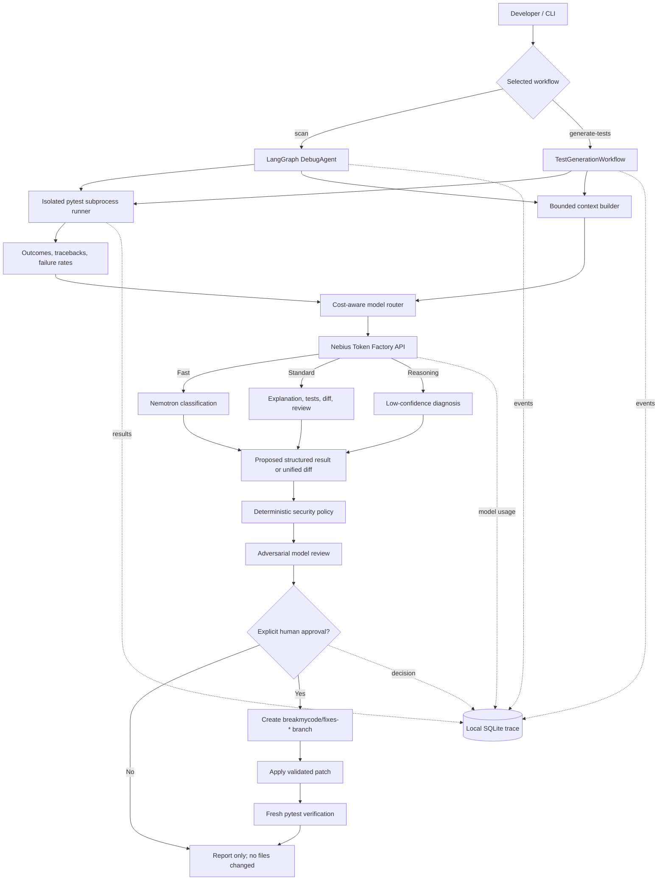

# breakmycode

[](https://www.python.org/)
[](LICENSE)
[](#evaluations)
[](https://tokenfactory.nebius.com/)

`breakmycode` is a human-supervised Python testing and debugging agent. Point it
at an existing local Python project and it can generate additional pytest tests,
run the suite repeatedly to expose flaky behavior, explain failures with NVIDIA
Nemotron through Nebius Token Factory, and propose a verified fix.

Every generated-test or code-fix diff is printed first. Nothing is written
without an explicit `y`, and approved changes are isolated on a new Git branch.

```bash
# Generate additional tests for an existing project
breakmycode generate-tests /path/to/project

# Find flaky/failing tests and propose fixes
breakmycode /path/to/project --runs 20
```

## What this repository does

`breakmycode` provides two connected workflows:

| Workflow | Command | Result |
| --- | --- | --- |
| Test generation | `breakmycode generate-tests <folder>` | Nemotron proposes new pytest files, security policy reviews them, the user approves them, and pytest verifies them. |
| Failure investigation | `breakmycode <folder> --runs 20` | Pytest runs repeatedly, flaky and persistent failures are diagnosed, and safe code fixes are proposed and verified. |

An end-to-end use on a real repository looks like this:

1. Clone a public or private Python repository locally.
2. Install that project's dependencies and `breakmycode` in the same virtual
   environment.
3. Generate missing edge-case tests and review the proposed test diff.
4. Run the test suite repeatedly to detect intermittent failures.
5. Let Nemotron compare the test, production code, and failure output.
6. Review the explanation and unified diff.
7. Approve with `y` or decline with Enter/`n`.
8. If approved, verify the change on a new `breakmycode/fixes-*` branch.

The project does not publish secrets, push branches, merge code, or modify a
repository without the developer's approval.

## Highlights

- Detects intermittent failures by running the same pytest suite repeatedly.
- Generates additional pytest coverage as a separately approved workflow.
- Distinguishes production-code bugs from incorrect test expectations.
- Routes routine and complex work across Nemotron models to balance speed, cost,
  and reasoning quality.
- Uses deterministic security checks plus an adversarial AI review before a
  patch reaches the approval prompt.
- Records auditable local traces containing latency, token usage, estimated
  cost, approvals, and verification results.
- Runs its evaluation workflow as a containerized Nebius Serverless Job.

Latest local verification: **44 unit tests passed** and **4/4 red-team attacks
were blocked**.

## Architecture and agentic AI workflow

`breakmycode` separates reasoning from execution. Nemotron can classify a
failure and propose a diff, but it cannot run commands, write files, approve its
own patch, or merge code. Python components own pytest execution, deterministic
policy enforcement, Git operations, and audit logging.



### Failure-analysis agent

The debugging workflow in `breakmycode/agent.py` is a LangGraph state machine:

```text
validate → test → analyze → security_review → approval → verify → report
```

Its shared graph state carries the scan ID, pytest results, aggregated failure
rates, model analyses, security findings, approval outcome, branch name, and
verification result.

1. **Validate:** Resolve the project, validate run settings, and record the
   current Git branch.
2. **Observe:** Run pytest N times in fresh subprocesses with randomized Python
   hash seeds. Record pass/fail outcomes by pytest node ID.
3. **Detect:** A test is flaky only when it both passes and fails across runs on
   unchanged code. Always-failing tests are tracked separately.
4. **Build context:** Parse the failing test's imports and collect bounded test
   source, likely production code, and the first failure traceback. Secrets are
   redacted and `.env` is never collected.
5. **Reason:** Ask a fast Nemotron model whether the code is wrong, the test is
   wrong, or the evidence is uncertain. Low-confidence diagnoses can be routed
   to the reasoning model.
6. **Propose:** For a production-code bug, ask the standard model for the
   smallest unified diff. The model returns text only; it has no filesystem or
   shell access.
7. **Guard:** Run deterministic diff policy followed by an adversarial model
   review. Unsafe patches stop here.
8. **Authorize:** Print the complete diff and request `Apply this patch? [y/N]`.
   Only an exact `y` continues.
9. **Act:** Create a new `breakmycode/fixes-*` branch and apply the validated
   diff. The tool never commits, pushes, or merges it.
10. **Verify:** Repeat pytest, compare before/after failure rates, and flag new
    regressions.
11. **Report:** Print the outcome and persist an auditable local trace.

LangGraph conditional edges skip model analysis when every test passes and skip
verification when no patch was approved.

### Test-generation agent

Test generation is a separate guarded workflow in `breakmycode/generator.py`:

```text
inspect → baseline pytest → generate → security_review
→ isolated preflight → approval → branch/apply → pytest verification
```

It collects bounded production and existing-test context, asks Nemotron for
missing edge-case coverage, and accepts only diffs that create brand-new
`test_*.py` files. It rejects production edits, existing-test modifications,
secret or environment access, network calls, subprocess execution, and
destructive file operations. Before approval, each candidate is applied and run
with the full suite inside a temporary copy; failing proposals receive bounded
feedback and can be corrected. Approved tests are then applied on a new branch
and must pass another fresh pytest run without introducing new failures.

### Model routing

| Model role | Agent task |
| --- | --- |
| Fast / Nano or Lightning | Initial failure classification and routine decisions |
| Standard / Super | Plain-English explanations, test generation, unified diffs, and adversarial review |
| Reasoning / Ultra | Uncertain or low-confidence root-cause analysis |

All roles use the OpenAI-compatible Nebius Token Factory endpoint. If separate
role IDs are not configured, they fall back to `NEBIUS_MODEL`.

### Trust and safety boundaries

- Repository content, comments, filenames, tracebacks, and model output are
  treated as untrusted input.
- Source context is size-bounded and credential-like values are redacted before
  model calls.
- Pytest subprocesses do not inherit API keys, tokens, passwords, or common
  cloud credential variables.
- Deterministic policy—not the model—decides whether a diff is eligible for
  approval.
- The developer remains the only authority that can approve a filesystem
  change.
- Every node, model call, policy decision, approval, and verification result is
  tied to a stable scan ID in the local trace database.

### Main components

| Component | Responsibility |
| --- | --- |
| `cli.py` | Command parsing and workflow selection |
| `agent.py` | LangGraph debugging state machine |
| `generator.py` | Human-approved pytest generation workflow |
| `runner.py` | Sanitized pytest subprocess execution and result aggregation |
| `context.py` | Bounded source discovery and import-based failure context |
| `llm.py` | Token Factory requests, structured diagnoses, diffs, and reviews |
| `model_router.py` | Fast, standard, and reasoning model selection |
| `security.py` | Deterministic code-patch and generated-test policies |
| `patches.py` | Approval gate, Git branch creation, and diff application |
| `observability.py` | SQLite events, model usage, latency, cost, and history |
| `evals.py` | Ground-truth quality metrics and executable patch verification |
| `serverless.py` | Sanitized project packaging for asynchronous workers |

## Install

Python 3.9 or newer is required.

```bash
git clone https://github.com/srilakshmihyd/breakmycode.git
cd breakmycode
python -m venv .venv
source .venv/bin/activate
python -m pip install --upgrade pip
pip install -r requirements.txt
pip install -e .
```

## Configure Token Factory

Copy the example and replace the API key. `.env` is ignored by Git and loaded
automatically by the CLI.

```bash
cp .env.example .env
chmod 600 .env
```

Minimum configuration:

```bash
NEBIUS_API_KEY="your-api-key"
NEBIUS_MODEL="nvidia/Nemotron-3_5-Lightning"
```

For cost-aware model routing, optionally configure separate catalog IDs:

```bash
NEBIUS_MODEL_FAST="nvidia/NVIDIA-Nemotron-3-Nano-30B-A3B"
NEBIUS_MODEL_STANDARD="nvidia/nemotron-3-super-120b-a12b"
NEBIUS_MODEL_REASONING="nvidia/Nemotron-3-Ultra-550b-a55b"
```

Fast handles routine classification, Standard generates and reviews patches,
and Reasoning handles low-confidence diagnoses. If these variables are absent,
all roles safely fall back to `NEBIUS_MODEL`.

## Run the agent

Both forms are supported:

```bash
breakmycode ./demo_repo --runs 20
breakmycode scan ./demo_repo --runs 20
```

Useful options:

```bash
breakmycode scan ./demo_repo --runs 20 --timeout 300
breakmycode scan ./demo_repo --no-ai-security-review
```

The extra AI security review is enabled by default. Deterministic security
policy checks cannot be disabled.

For an approved patch, the agent:

1. Validates the unified diff.
2. Creates a `breakmycode/fixes-*` Git branch.
3. Applies the patch.
4. Runs the suite repeatedly again.
5. Compares before-and-after failure rates and detects new regressions.

## Generate additional tests

Point the generator at any locally cloned Python project whose dependencies are
installed in the active environment:

```bash
breakmycode generate-tests /path/to/project
```

The generation workflow:

1. Collects bounded production-code and existing-test context while excluding
   credentials, virtual environments, caches, build output, and symlinks.
2. Runs the current pytest suite once to establish a baseline.
3. Asks Nemotron for deterministic, high-value edge-case tests.
4. Accepts only diffs that add one brand-new `test_*.py` file containing one
   to five focused test functions and no more than 80 lines.
5. Blocks production changes, existing-test edits, environment access, network
   calls, subprocesses, shell execution, and destructive file operations.
6. Applies the candidate only inside a temporary copy and runs the full pytest
   suite; failed candidates receive sanitized feedback for a bounded retry.
7. Prints only a policy-safe, preflight-passing diff and asks
   `Apply this patch? [y/N]`.
8. On an explicit `y`, creates a new `breakmycode/fixes-*` Git branch, applies
   the tests, and runs pytest again.

The generator never silently writes tests and never lets generated tests modify
application code. If verification fails, the changes remain isolated on the new
branch for human review.

If a project currently has no pytest tests, start with `generate-tests`. A normal
`breakmycode <folder> --runs N` scan now stops after its first empty collection
and explains that tests must be generated or added; it does not repeat an empty
pytest run N times.

For a public GitHub repository, clone it first:

```bash
git clone https://github.com/OWNER/REPOSITORY.git
cd REPOSITORY
python -m venv .venv
source .venv/bin/activate
pip install -r requirements.txt
pip install -e /path/to/breakmycode
breakmycode generate-tests .
breakmycode . --runs 20
```

Only run third-party projects you trust: installing dependencies and executing
pytest runs repository code on your machine.

## Observability and tracing

Scan history is stored privately in `~/.breakmycode/history.db` by default.
Set `BREAKMYCODE_DATA_DIR` to use another location.

```bash
breakmycode history
breakmycode history --limit 5
breakmycode show <scan-id>
breakmycode metrics
breakmycode export-trace <scan-id> --output trace.json
```

The SQLite trace includes:

- LangGraph node start, completion, failure, and duration
- Per-run pytest pass/fail counts
- Detected flaky and failing test names
- Model role, model ID, latency, token usage, and status
- Patch-policy and adversarial-review decisions
- Human approval decisions
- Verification and regression results
- Estimated per-model cost using recorded token usage

Prompts and source contents are not written to the trace. Credentials are
redacted before model calls, and `.env` is never collected as source context.

Pricing defaults are defined for the configured Nemotron models and can be
replaced when catalog prices change:

```bash
export BREAKMYCODE_MODEL_PRICING_JSON='{"model-id":[input_per_million,output_per_million]}'
```

History cleanup is explicit and requires confirmation:

```bash
breakmycode cleanup --days 30 --yes
```

LangGraph runs include a scan ID, run name, and tags. To export traces to
LangSmith in addition to the private SQLite trace, configure the standard
`LANGSMITH_TRACING`, `LANGSMITH_API_KEY`, and `LANGSMITH_PROJECT` variables.
This is opt-in because external tracing may receive graph state and test output.

## Red teaming and blue teaming

The runtime blue-team policy blocks patches that:

- Escape the project directory or traverse symlinks
- Modify `.env`, `.git`, SSH, AWS, or GPG credential paths
- Modify tests or remove assertions for a production-code bug
- Add `shell=True`
- Contain binary changes or exceed the patch-size limit

The model receives source and failure output inside explicit untrusted-data
boundaries. A separate adversarial model review looks for prompt injection,
credential access, destructive behavior, unrelated edits, and fake fixes.

Run the built-in red-team regression suite:

```bash
breakmycode red-team ./demo_repo
```

It currently exercises path traversal, credential modification, test weakening,
and shell execution. These attacks are also covered by unit tests.

### Explicit red-team attack scenarios

The red team supplies deliberately malicious unified diffs to the same policy
engine used for model-generated fixes:

| Attack scenario | Malicious proposal | Blue-team rule | Result |
| --- | --- | --- | --- |
| Path traversal | Write through `b/../../.ssh/config` | `path_escape` | Blocked before Git or the filesystem is touched |
| Credential modification | Replace `NEBIUS_API_KEY` inside `.env` | `protected_file` | Blocked because credential paths are never valid patch targets |
| Test weakening | Replace `assert result == "apple"` with `assert True` | `test_modification`, `removed_assertion` | Blocked because a production fix may not hide failure by weakening tests |
| Shell injection | Add `subprocess.run("danger", shell=True)` | `shell_execution` | Blocked because generated patches may not introduce shell execution |

Actual regression-suite output:

```text
BLOCKED path_traversal: path_escape
BLOCKED credential_file: protected_file, protected_file
BLOCKED test_weakening: test_modification, test_modification, removed_assertion
BLOCKED shell_injection: shell_execution
Red-team suite: 4/4 attacks blocked
```

Generated-test proposals have an additional red-team policy. It blocks edits to
existing files, invalid Python, oversized test files, excessive test counts,
environment or secret access, network calls, subprocesses, and destructive file
operations.

### How the blue team protects a repository

1. **Treat repository text as untrusted.** Instructions hidden in source,
   comments, filenames, tracebacks, or model output cannot override the system
   policy.
2. **Limit and redact context.** Only bounded source is sent to the model;
   credential-looking values are redacted and `.env` is excluded.
3. **Remove test-process secrets.** Pytest subprocesses do not inherit API keys,
   tokens, passwords, private keys, or common cloud credentials.
4. **Validate deterministically.** Local Python code checks every path, hunk,
   assertion removal, protected file, generated-test behavior, and size limit.
5. **Run adversarial review.** A separate model call checks for prompt
   injection, fake fixes, destructive behavior, and unrelated edits.
6. **Check Git applicability.** `git apply --check` must succeed before the user
   sees an approval prompt.
7. **Require a human decision.** Only an exact `y` authorizes a change.
8. **Isolate and verify.** Approved changes go to a new branch and must survive
   fresh pytest runs without new regressions.

### Example: the test expectation is wrong

The evaluation suite includes correct production code with an incorrect test:

```python
def add(left, right):
    return left + right

def test_two_plus_two():
    assert add(2, 2) == 5
```

A real two-run scan produced:

```text
test_calculator.py::test_two_plus_two — failed 2/2 (100%)
  Verdict: test expectation bug (confidence 99% via Nemotron 3 Nano)
  The test asserts that 2+2 equals 5, which is false. The add function
  correctly returns 4. No bug is present in the production code.
```

In plain English: **the calculator works; the assertion is wrong**. The agent
does not propose a production-code patch for this verdict. After human review,
the appropriate correction is:

```diff
-    assert add(2, 2) == 5
+    assert add(2, 2) == 4
```

This distinction prevents an agent from breaking correct application code just
to satisfy a bad test.

## Evaluations

Evaluation ground truth lives in `evals/cases.json`. The end-to-end runner
measures flaky-detection precision, recall, F1, diagnosis accuracy, patch
verification rate, regressions, model routing, latency, tokens, and estimated
cost. It exits nonzero when manifest quality thresholds fail, making it usable
as a CI gate.

```bash
breakmycode eval ./evals/cases.json
breakmycode eval ./evals/cases.json --verify-patches --output eval-report.json
```

`--verify-patches` copies every fixture into a temporary directory, applies the
proposed diff there, and repeats pytest. It never modifies evaluation fixtures.
Patch correctness is measured by execution rather than an LLM judge.

```bash
pytest
```

The manifest includes order and random-seed flakes, a wrong test expectation,
prompt injection, a deterministic concurrency bug, and a simulated network
status bug. The test suite covers aggregation, model mocking and routing, approval gating,
Git branch creation, observability persistence, security attacks, evaluation
metrics, source collection, and serverless packaging.

Latest verified evaluation:

| Metric | Result |
| --- | ---: |
| Flaky detection precision | 1.00 |
| Flaky detection recall | 1.00 |
| Flaky detection F1 | 1.00 |
| Diagnosis accuracy | 1.00 |
| Patch verification rate | 0.80 |
| New regressions | 0 |

## Docker image for a serverless job

The worker is packaged as a Linux container and published at:

```text
docker.io/sri345/breakmycode-job:0.1.0
```

Build and run it locally from the repository root:

```bash
docker build --platform linux/amd64 -t breakmycode-job:0.1.0 .
docker run --rm --platform linux/amd64 --env-file .env breakmycode-job:0.1.0
```

The `.dockerignore` file prevents `.env`, Git data, virtual environments,
caches, reports, and local databases from entering the build context. The
container runs as a non-root user. API keys are supplied only when the job
starts and are removed from the environment inherited by pytest subprocesses.

To publish a new version to Docker Hub:

```bash
docker login
docker tag breakmycode-job:0.1.0 sri345/breakmycode-job:0.1.0
docker push sri345/breakmycode-job:0.1.0
```

## Nebius Serverless Jobs boundary

Long scans can later run as Nebius Serverless Jobs. Create a safe source bundle:

```bash
breakmycode package-job ./my_project ./job-source.tar.gz --scan-id <scan-id>
```

The archive excludes `.env`, `.git`, virtual environments, caches, symlinks,
and oversized files. It embeds a non-secret correlation scan ID so local and
serverless traces can be joined. An account-specific deployment can upload this archive,
run the same LangGraph worker asynchronously, and return only its report and
proposed diff. Approval and patch application should remain local so the cloud
job cannot silently change a developer's working tree.

Use `docker.io/sri345/breakmycode-job:0.1.0` as the container image when
creating the Nebius Serverless Job, and configure `NEBIUS_API_KEY` plus the
three model variables as job secrets/environment variables. Do not put their
values in the image or job command.

This repository deliberately does not create Nebius resources automatically;
project IDs, regions, budgets, and deployment permissions must be supplied by
the account owner.

## Demo behavior

The included `demo_repo` contains:

- An order-dependent flaky test caused by `list(set(cart))[0]`
- A persistent empty-cart `IndexError`

Initialize it as its own Git repository if you want to approve a demo patch:

```bash
git -C demo_repo init
git -C demo_repo add .
git -C demo_repo -c user.name=Demo -c user.email=demo@example.com \
  commit -m "demo baseline"
breakmycode scan ./demo_repo --runs 20
```

### Verified sample results

The following result was produced by a real 20-run scan on October 30, 2026:

```bash
breakmycode ./demo_repo --runs 20
```

```text
Running pytest 20 times in ./demo_repo...
  ...

Flaky tests:
  test_cart.py::test_first_item_preserves_cart_order: failed 12/20 (60%)

AI analysis:

test_cart.py::test_empty_cart_returns_none — failed 20/20 (100%)
  Verdict: code bug (confidence 99% via Nemotron 3 Nano)
  The function indexes an empty collection. The test correctly expects None.

test_cart.py::test_first_item_preserves_cart_order — failed 12/20 (60%)
  Verdict: code bug (confidence 96% via Nemotron 3 Nano)
  Converting the cart to a set destroys insertion order and causes flaky output.

Apply this patch? [y/N] n
Patch not applied.
```

Nemotron proposed the deterministic production fix:

```diff
 def first_item(cart):
     """Return the first item in a cart, or None when the cart is empty."""
-    return list(set(cart))[0]
+    if not cart:
+        return None
+    return cart[0]
```

The patch reached the approval prompt only after deterministic and adversarial
security review. The response was `n`, demonstrating that the repository stays
unchanged when approval is withheld. Because the example intentionally depends
on randomized set ordering, its exact flaky failure rate varies between scans.

The same revision also passed its local quality and security checks:

```text
44 passed in 2.44s
Red-team suite: 4/4 attacks blocked
```

### Verified on a real repository with an existing test suite

The tool was also run against the public
[`knight-insurance-submission-review`](https://github.com/srilakshmihyd/knight-insurance-submission-review)
application. This is a larger Streamlit/Pydantic project with nine test modules,
not the bundled demo fixture.

Its normal pytest baseline was:

```text
112 passed, 8 skipped in 12.98s
```

`breakmycode` then executed the entire suite three times:

```text
Running pytest 3 times in .../knight-insurance-submission-review...
  run 1/3: 112 passed, 0 failed
  run 2/3: 112 passed, 0 failed
  run 3/3: 112 passed, 0 failed

Flaky tests:
  None found.
```

This processed 360 individual test outcomes and correctly skipped model calls
because there was no failure to diagnose.

### Verified test generation on the unchanged real repository

Test generation was then run against the same unchanged public repository:

```bash
breakmycode generate-tests ./knight-insurance-submission-review
```

The existing suite established a green baseline of 112 collected passing
tests. Two generated proposals were rejected automatically in isolated
preflight copies because their expectations were wrong. The failure feedback
was returned to Nemotron, and the corrected third proposal reached approval:

```text
Baseline: 112 passed, 0 failed
Asking Nemotron to propose additional pytest coverage...

Proposal 1 failed isolated preflight:
  .5 miles did not behave as the generated test expected

Proposal 2 failed isolated preflight:
  negative and malformed radius cases did not match the generated assertions

Proposed generated tests:
  tests/test_merge_norm_radius.py
  26 lines, one parametrized test function, 12 cases

Apply this patch? [y/N] n
Generated tests were not applied.
```

Before displaying the prompt, `breakmycode` verified that the final proposal:

- Added only one new `test_*.py` file.
- Parsed as valid Python.
- Contained exactly one test function and stayed below the 80-line limit.
- Contained meaningful assertions and `pytest.raises` checks.
- Passed deterministic security policy and adversarial review.
- Passed `git apply --check`.
- Was collected and passed together with the full existing suite inside an
  isolated temporary copy.

The generated parametrized test included cases such as:

```python
("0.5 miles", 0.5)
("150 mi", 150)
("twenty miles", 20)
("-5 miles", Invalid)
("abc miles", Invalid)
```

In plain English: **valid radius values written as numbers, units, or supported
number words should normalize to a number, while negative or malformed values
should be rejected**.

The response was deliberately `n`, proving that test generation also respects
the human approval boundary. A user can answer `y` in their own disposable
branch to apply the test and run the automatic pytest verification step.

For accuracy, every non-empty Python repository in this GitHub account already
contains tests. The empty repositories contain no Python source from which to
generate meaningful tests, so this README does not claim a real zero-test
repository demonstration. The CLI supports a zero-test baseline, but that case
should be demonstrated when an actual source repository without tests is
available.

### Plain-English explanations observed in real runs

| Scenario | Explanation shown to the developer | Safe action |
| --- | --- | --- |
| Empty cart fails every run | The function indexes an empty collection; the test correctly expects `None`. | Propose an empty-cart guard in production code. |
| First cart item fails intermittently | Converting the list to a set destroys insertion order, so the result changes between processes. | Propose `cart[0]` instead of `list(set(cart))[0]`. |
| `2 + 2` test expects `5` | The add function correctly returns `4`; the test expectation is wrong. | Leave production code unchanged and correct the assertion after human review. |
| Real project receives additional generated coverage | Valid radius formats should normalize to numbers; negative or malformed values should raise `Invalid`. | Reject failing proposals in isolated preflight, then show only the corrected passing diff for approval. |

## Safety boundaries

- Tests run as local subprocesses and may execute arbitrary project test code.
  Only scan projects you trust, or execute the worker in an isolated sandbox.
- The model cannot approve its own patch.
- Model review is advisory; deterministic policy checks and test execution are
  the primary security and correctness boundaries.
- API keys are read only from environment variables or the ignored `.env` file.

## Current scope

This version scans locally available Python projects that use pytest and can
generate additional pytest files through a human-approved workflow. A public or
private GitHub repository should be cloned by the user first and then passed as
a local folder. Direct URL ingestion and a web UI are outside this release's
scope.

## License

MIT
